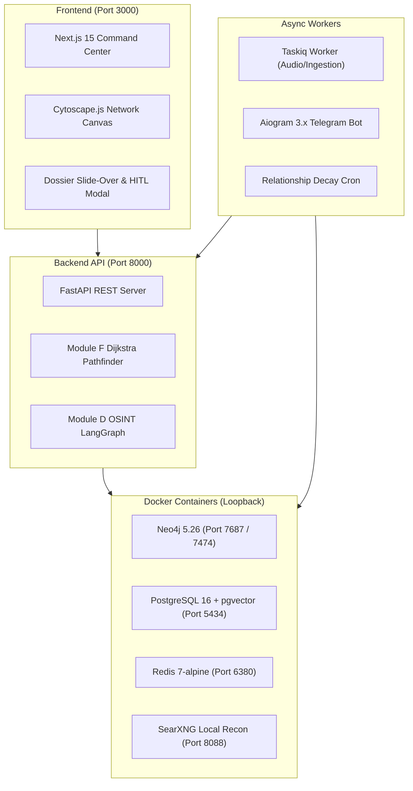

# Lokachakra Local Execution Walkthrough

This guide walks you through running the entire Lokachakra Bi-Temporal Personal Intelligence Graph locally on your Windows machine.
Each component can be run alongside Docker Desktop using the pre-configured environment.

---

## 1. System Requirements & Architecture Overview

Lokachakra consists of four core layers running on your workstation:



### Installed Tooling
- **Python**: 3.12+ (Python 3.13 with `uv` virtual environment installed in `.venv/`).
- **Node.js**: v24.11.1 with `npm` 11.6+.
- **Docker Desktop**: Windows Docker Engine running containers with 127.0.0.1 bindings.

---

## 2. Infrastructure Services (Docker)

All data stores are configured in [docker-compose.yml](file:///C:/Users/amand/OneDrive/Documents/Projects/Monthly/LokaChakra/docker-compose.yml).
Open PowerShell in the project root:

```powershell
cd C:\Users\amand\OneDrive\Documents\Projects\Monthly\LokaChakra
```

### Start the Storage Stack
Run the following command to start PostgreSQL, Neo4j, Redis, and SearXNG in detached mode:

```powershell
docker compose up -d postgres neo4j redis searxng
```

### Verify Container Health
Run `docker ps` to verify all services are active and healthy:

```powershell
docker ps --format "table {{.Names}}\t{{.Status}}\t{{.Ports}}"
```

You should see:
- `lokachakra-neo4j`: Up (healthy) on `127.0.0.1:7474` (HTTP) and `127.0.0.1:7687` (Bolt).
- `lokachakra-postgres`: Up (healthy) on `127.0.0.1:5434->5432/tcp`.
- `lokachakra-redis`: Up on `127.0.0.1:6380->6379/tcp`.
- `lokachakra-searxng`: Up on `127.0.0.1:8088->8080/tcp`.

> [!NOTE]
> Neo4j Web Browser can be accessed directly at http://localhost:7474 with username `neo4j` and password `lokachakra_secure_neo4j`.

---

## 3. Database Initialization (One-Time Setup)

The PostgreSQL schema and Neo4j constraints are maintained in the `scripts/` folder.

### PostgreSQL Schema & pgvector Extension
Run the PostgreSQL initialization script into the container:

```powershell
Get-Content scripts/init_postgres.sql | docker exec -i lokachakra-postgres psql -U lokachakra -d lokachakra_db
```

### Neo4j Uniqueness Constraints & Indices
Apply the Cypher indices and seed the `SELF_USER` root identity:

```powershell
Get-Content scripts/init_neo4j.cypher | docker exec -i lokachakra-neo4j cypher-shell -u neo4j -p lokachakra_secure_neo4j
```

---

## 4. Running the Backend Services

Open a new PowerShell terminal for the backend API and worker processes.

### Terminal A: FastAPI REST API Server
Start the Uvicorn development server:

```powershell
uv run uvicorn src.api.main:app --host 127.0.0.1 --port 8000 --reload
```

- API Base URL: http://127.0.0.1:8000
- Interactive Swagger UI: http://127.0.0.1:8000/docs
- ReDoc Documentation: http://127.0.0.1:8000/redoc
- Health Check: http://127.0.0.1:8000/health

### Terminal B: Taskiq Background Worker
To process voice note transcription and asynchronous background ingestion jobs:

```powershell
uv run taskiq worker src.ingestion.tasks:broker
```

### Terminal C (Optional): Telegram HITL Bot
If you have configured `TELEGRAM_BOT_TOKEN` in your `.env`:

```powershell
uv run python -m src.hitl_bot.bot
```

### Terminal D (Optional): Run Relationship Decay Job
To manually execute the nightly exponential trust decay and bridge degree alert check:

```powershell
uv run python -c "import asyncio; from src.pathfinder.decay_cron import run_nightly_decay_job; print(asyncio.run(run_nightly_decay_job()))"
```

---

## 5. Running the Next.js Frontend Command Center

Open a separate PowerShell terminal for the web interface.

### Install Node Dependencies
Navigate into the `frontend/` directory and install packages:

```powershell
cd C:\Users\amand\OneDrive\Documents\Projects\Monthly\LokaChakra\frontend
npm install
```

### Start Development Server
Launch the Next.js 15 dev server:

```powershell
npm run dev
```

Open your browser and navigate to:
**http://localhost:3000**

---

## 6. Testing the End-to-End System

### Run the Full Pytest Suite
To run all 25 unit and integration tests across the entire codebase:

```powershell
uv run pytest tests/ -v
```

All four automated test suites should pass cleanly:
1. [tests/test_extractor.py](file:///C:/Users/amand/OneDrive/Documents/Projects/Monthly/LokaChakra/tests/test_extractor.py): LLM extraction and CSV parsing.
2. [tests/test_resolver.py](file:///C:/Users/amand/OneDrive/Documents/Projects/Monthly/LokaChakra/tests/test_resolver.py): 3-tier entity resolution and job transition edge closing.
3. [tests/test_osint_hitl.py](file:///C:/Users/amand/OneDrive/Documents/Projects/Monthly/LokaChakra/tests/test_osint_hitl.py): SearXNG OSINT, LangGraph interrupt/resume, and Telegram notifier.
4. [tests/test_pathfinder.py](file:///C:/Users/amand/OneDrive/Documents/Projects/Monthly/LokaChakra/tests/test_pathfinder.py): Dynamic weighted Dijkstra routing and REST endpoints.

---

## 7. Interactive Usage Examples

### 1. Ingest Observation via API
You can send conversation notes or transcripts directly:

```powershell
Invoke-RestMethod -Method Post -Uri "http://127.0.0.1:8000/api/v1/ingest/text" `
  -Headers @{ "Content-Type" = "application/json" } `
  -Body '{"text": "Met Rohan Sharma today. He introduced me to Siddharth Verma who leads engineering at Stripe in Bengaluru. Rohan previously studied at IIT Delhi."}'
```

### 2. Search for the Warmest Path
In the search bar at the top of http://localhost:3000, type:
```
Stripe
```
- The pathfinder will compute the minimum-cost route from `SELF_USER` to `Stripe`.
- The connecting path nodes and edges glow in Cyan (`#06b6d4`), while non-path nodes dim to 25% opacity.
- An actionable warm introduction script is generated ready to copy.

### 3. Inspect Person Dossier
- Click on any person node in the Cytoscape graph canvas.
- The right-hand drawer slides out displaying:
  - Trust Score gauge (0 to 100).
  - Active vs. Past career roles with bi-temporal date badges.
  - Verbatim audio/text provenance quotes.
  - One-click copy warm introduction button.

### 4. Review HITL Queue
- Click the **HITL Queue** button in the header.
- View pending identity merges or open-triangle bridge discoveries.
- Click **Confirm & Lock** or **Reject Match** to resume LangGraph state threads.
